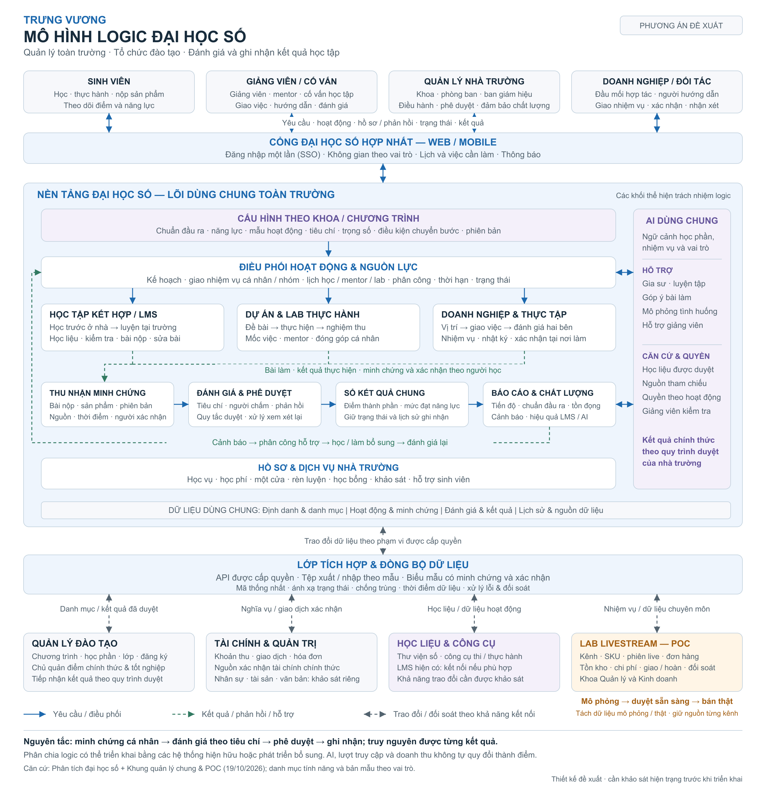

# Thuyết minh định hướng và phương pháp xây dựng Trường Đại học số Trưng Vương

> Bản văn bản của `THUYET_MINH_XAY_DUNG_DAI_HOC_SO_TRUNG_VUONG.docx` (cùng thư mục), để AI và người đọc tra cứu nhanh.
> Sơ đồ phụ lục: [mo-hinh-logic-dai-hoc-so.png](mo-hinh-logic-dai-hoc-so.png).

## 1. Quan điểm và mục tiêu xây dựng

Xây dựng Trường Đại học số Trưng Vương là quá trình đổi mới đồng bộ phương thức quản trị, tổ chức đào tạo và phục vụ người học trên nền tảng công nghệ và dữ liệu. Nội dung chuyển đổi bao gồm quy trình công việc, phương pháp giảng dạy, cơ chế đánh giá, trách nhiệm của các đơn vị và năng lực thực hiện của đội ngũ.

Mục tiêu trọng tâm là hình thành môi trường đào tạo gắn kết giữa kiến thức, thực hành và công việc thực tế; giúp sinh viên có khả năng chủ động học tập, tổ chức hoạt động, sử dụng công cụ số và chịu trách nhiệm về kết quả. Nhà trường đồng thời nâng cao năng lực điều hành, phát hiện sớm hạn chế và phân bổ nguồn lực phù hợp.

Định hướng này được cụ thể hóa thành ba yêu cầu: hoạt động có kế hoạch và người chịu trách nhiệm; kết quả có minh chứng và tiêu chí đánh giá; thông tin quản lý được sử dụng để hỗ trợ người học và cải tiến chất lượng.

## 2. Phương pháp luận xây dựng đại học số

Thứ nhất, tiếp cận từ yêu cầu năng lực và kết quả đầu ra. Việc thiết kế đào tạo bắt đầu từ những công việc người học cần thực hiện được sau khi hoàn thành chương trình. Trên cơ sở đó, xác định năng lực, kiến thức nền, nhiệm vụ thực hành, sản phẩm và tiêu chí đánh giá tương ứng. Cách tiếp cận này tạo sự liên kết giữa chương trình đào tạo với yêu cầu sử dụng nhân lực.

Thứ hai, tiếp cận theo quá trình. Mỗi hoạt động được xem xét trong toàn bộ chu trình từ xác định nhu cầu, lập kế hoạch, bố trí nguồn lực, tổ chức thực hiện đến đánh giá và điều chỉnh. Việc số hóa phải làm rõ các bước xử lý, điều kiện chuyển bước, trách nhiệm phối hợp và phương án giải quyết ngoại lệ.

Thứ ba, tiếp cận dựa trên minh chứng. Nhận định về chất lượng học tập và hiệu quả quản lý phải có dữ liệu phù hợp để kiểm tra. Minh chứng cần thể hiện người thực hiện, bối cảnh, thời điểm, sản phẩm và kết quả xác nhận.

Thứ tư, triển khai theo chu trình cải tiến liên tục. Nhà trường tổ chức thí điểm, đo lường kết quả, xác định nguyên nhân hạn chế, điều chỉnh và kiểm chứng lại trước khi mở rộng. Phạm vi triển khai được lựa chọn theo khả năng tạo ra kết quả thực chất và điều kiện duy trì hoạt động.

## 3. Đổi mới tổ chức đào tạo theo chu trình tạo giá trị

Đào tạo được tổ chức theo hướng liên kết bốn môi trường: tự học có hướng dẫn, học tập trực tiếp, thực hiện dự án và trải nghiệm tại doanh nghiệp. Mỗi môi trường đảm nhiệm một phần của quá trình hình thành năng lực; kết quả được kết nối trong cùng kế hoạch học tập.

Sinh viên tiếp cận kiến thức nền và thực hiện bài kiểm tra trước buổi học. Giảng viên sử dụng kết quả này để xác định nội dung cần giải đáp, phân nhóm và tổ chức thực hành. Sau buổi học, sinh viên hoàn thiện sản phẩm, tiếp nhận phản hồi và thực hiện nhiệm vụ bổ sung.

Dự án thực hành được thiết kế theo một chu trình tạo giá trị tương đối hoàn chỉnh: nghiên cứu nhu cầu, lựa chọn sản phẩm hoặc giải pháp, lập phương án, tổ chức tiếp cận khách hàng, thực hiện giao dịch, cung ứng, chăm sóc sau giao dịch và phân tích kết quả. Qua đó, sinh viên hiểu được mối liên hệ giữa quyết định ban đầu với chất lượng vận hành và kết quả cuối cùng.

Một dự án có thể huy động kiến thức của nhiều học phần. Khi đó, khoa cần xác định rõ học phần tham gia, năng lực được đánh giá, sản phẩm sử dụng chung và trách nhiệm của giảng viên. Mỗi học phần ghi nhận kết quả theo tiêu chí riêng đã được phê duyệt.

Đối với dự án nhóm, cần phân công và luân phiên vai trò phù hợp để sinh viên được rèn luyện nhiều khâu công việc. Việc đánh giá phải xác định được đóng góp, mức độ tự chủ và khả năng giải thích quyết định của từng cá nhân.

## 4. Đổi mới đánh giá và ghi nhận kết quả học tập

Đánh giá được thực hiện xuyên suốt quá trình đào tạo, kết hợp kiến thức nền, thao tác thực hành, sản phẩm, khả năng xử lý tình huống và năng lực vận dụng. Tiêu chí phải mô tả được biểu hiện cần quan sát, mức độ yêu cầu và điều kiện thực hiện.

Cần phân biệt ba nhóm thông tin:

- Thông tin tham gia: mức độ chuẩn bị, tiến độ, thời gian thực hiện và nhiệm vụ đã hoàn thành.

- Kết quả chuyên môn: chất lượng sản phẩm, độ chính xác, thời gian xử lý, phản hồi của khách hàng và hiệu quả vận hành.

- Kết quả học tập: mức đáp ứng tiêu chí, điểm thành phần, năng lực đạt được và nội dung cần bổ sung.

Ba nhóm thông tin có quan hệ với nhau nhưng được sử dụng theo mục đích khác nhau. Chẳng hạn, kết quả kinh doanh chịu ảnh hưởng của nguồn lực, đặc điểm sản phẩm, thời điểm và điều kiện tiếp cận khách hàng. Khi đánh giá sinh viên, cần xem xét chất lượng phân tích, quyết định, thao tác và khả năng cải tiến trong bối cảnh được giao.

Mỗi kết quả được ghi nhận phải có căn cứ truy nguyên đến nhiệm vụ, minh chứng, tiêu chí và người đánh giá. Việc điều chỉnh, đánh giá lại hoặc xem xét kết quả phải có thẩm quyền, lý do và lịch sử xử lý.

Thông tin đánh giá đồng thời được sử dụng để lập kế hoạch hỗ trợ. Sinh viên chưa đạt cần được xác định rõ nội dung còn thiếu, nhiệm vụ bổ sung, người hướng dẫn và thời điểm kiểm tra lại.

## 5. Đổi mới quản trị và phát triển môi trường số

Công tác quản trị được tổ chức theo nguyên tắc phân định trách nhiệm và phối hợp trên dữ liệu thống nhất. Mỗi quy trình cần xác định đơn vị chủ trì, đơn vị phối hợp, người quyết định, thời hạn và kết quả đầu ra.

Nhà trường chuẩn hóa các nội dung dùng chung như hồ sơ người học, chương trình, học phần, nhiệm vụ, nguồn lực, minh chứng và kết quả. Các đơn vị chuyên môn được cấu hình nội dung, tiêu chí và cách tổ chức phù hợp trong khuôn khổ quản lý chung. Cách thực hiện này tạo điều kiện dùng lại quy trình, giảm nhập liệu nhiều lần và hỗ trợ tổng hợp thông tin toàn trường.

Môi trường số phải giúp người sử dụng tiếp cận đúng công việc cần thực hiện. Sinh viên theo dõi nhiệm vụ, hạn hoàn thành và phản hồi; giảng viên theo dõi mức độ chuẩn bị, bài chờ đánh giá và trường hợp cần hỗ trợ; cấp quản lý theo dõi tiến độ, chất lượng và tình trạng sử dụng nguồn lực.

Dữ liệu phục vụ điều hành phải xác định rõ nguồn, thời điểm cập nhật, phạm vi và trạng thái xác nhận. Mỗi cảnh báo cần gắn với người xử lý và kết quả sau can thiệp. Nhờ đó, báo cáo trở thành công cụ tổ chức hành động và kiểm tra hiệu quả quản lý.

## 6. Phương pháp ứng dụng trí tuệ nhân tạo

Trí tuệ nhân tạo được sử dụng trong những nhiệm vụ có mục tiêu và phạm vi rõ ràng, gồm hỗ trợ giải thích học liệu, luyện tập, phản biện phương án, mô phỏng khách hàng, góp ý sản phẩm và phân tích thông tin.

Trong đào tạo, cần xác định mức hỗ trợ được phép đối với từng nhiệm vụ. Sinh viên có trách nhiệm kiểm chứng nội dung, giải thích lựa chọn và chịu trách nhiệm về sản phẩm nộp. Giảng viên kiểm tra các đề xuất được sử dụng trong giảng dạy, phản hồi và đánh giá.

Hiệu quả ứng dụng được xem xét thông qua chất lượng bài làm, khả năng giải thích, mức độ vận dụng sau hỗ trợ và thời gian phản hồi. Dữ liệu sử dụng công cụ chỉ cung cấp thông tin bổ trợ. Việc ứng dụng phải đồng thời phát triển năng lực tự học, tư duy phản biện và khả năng làm việc độc lập của sinh viên.

## 7. Phương pháp tổ chức thí điểm và mở rộng

Giai đoạn thí điểm cần lựa chọn một phạm vi đủ tập trung để kiểm chứng toàn bộ quá trình đào tạo và vận hành. Nội dung thực hành bao gồm nghiên cứu khách hàng, xây dựng phương án sản phẩm, lập kế hoạch nội dung và kênh triển khai, tổ chức bán hàng, xử lý đơn, cung ứng, chăm sóc khách hàng, theo dõi chi phí và phân tích dữ liệu.

Quá trình thực hiện được chia thành bốn bước:

- **Bước 1 — Chuẩn bị:** xác định học phần, năng lực, nhiệm vụ, tiêu chí; phân công giảng viên; chuẩn bị học liệu, không gian thực hành, công cụ và nguồn lực.

- **Bước 2 — Mô phỏng:** tổ chức luyện tập toàn bộ quy trình, bao gồm tình huống phát sinh; kiểm tra khả năng phối hợp, xử lý công việc và ghi nhận minh chứng.

- **Bước 3 — Vận hành thực tế có kiểm soát:** triển khai khi đáp ứng điều kiện về năng lực, phương án, nguồn lực và trách nhiệm. Theo dõi riêng tình trạng đơn, giao hàng, thanh toán, hoàn trả và đối soát để xác định đúng kết quả.

- **Bước 4 — Đánh giá và hoàn thiện:** sinh viên báo cáo, bảo vệ sản phẩm và giải thích quyết định; giảng viên đánh giá năng lực; đơn vị quản lý rà soát quy trình, chất lượng dữ liệu và điều kiện vận hành.

Việc mở rộng được quyết định trên cơ sở ba nhóm kết quả: sự tiến bộ và mức độ tự chủ của sinh viên; khả năng tổ chức, hướng dẫn và đánh giá của đội ngũ; mức độ ổn định của quy trình, dữ liệu và nguồn lực. Những nội dung đã được kiểm chứng được chuẩn hóa thành phương pháp, học liệu và quy trình dùng chung; những hạn chế tiếp tục được điều chỉnh trước đợt triển khai tiếp theo.

## Phụ lục — Mô hình logic Đại học số Trưng Vương

